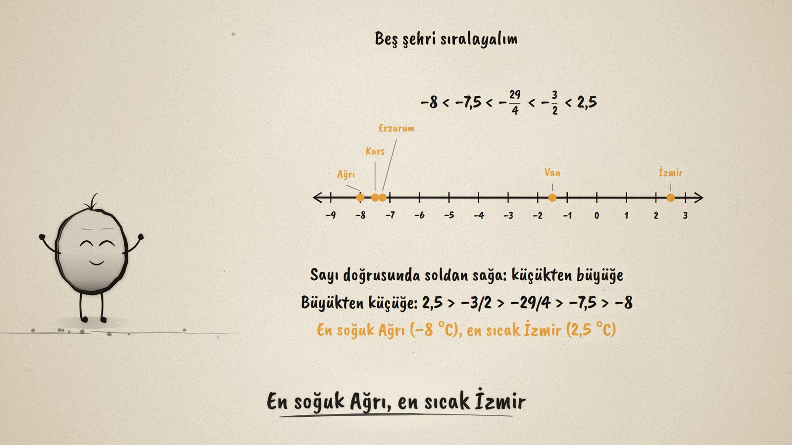
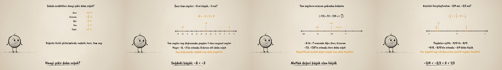

# Hangisi Daha Soğuk? · Comparing and Ordering Rational Numbers

**▶ Tarayıcıda izleyin / Watch in the browser:** https://hakanatas.github.io/hangisi-daha-soguk/ 
**⬇ MP4 + altyazılar / MP4 + subtitles:** [Releases](https://github.com/hakanatas/hangisi-daha-soguk/releases) 
**✎ Kullanılan istem / The prompt behind it:** [PROMPT.md](PROMPT.md) 
**🎞 Bütün filmler / All films:** [Nokta'nın Filmleri](https://hakanatas.github.io/nokta-filmleri/?sinif=7)

> **TR —** 7. sınıf matematik "Sayılar ve Nicelikler (1)" temasındaki MAT.7.1.3 öğrenme çıktısı için hazırlanmış, tamamen JavaScript ile çizilen 92 saniyelik mürekkep animasyonu. Bir kış sabahı beş şehrin sıcaklıkları farklı gösterimlerde veriliyor: Kars −7,5 °C, Erzurum −29/4 °C, Ağrı −8 °C, Van −3/2 °C, İzmir 2,5 °C. Önce tam sayılardan (paydası 1 olan rasyonel sayılar) başlanıyor: "8 > 3 ise −8 > −3 mü?" sorusu sayı doğrusunda çürüyor; sağdaki sayı daha büyük: −8 < −3 < 0 < 2. Sayı doğrusu −8 ile −7 arasına yakınlaşıyor: −8 < −7,5 < −29/4 < −7; negatiflerde mutlak değeri büyük olan daha küçük. Kesirler paydalar eşitlenerek karşılaştırılıyor: −3/4 = −9/12 < −8/12 = −2/3 < 0 < 1/3. Son olarak beş şehir sayı doğrusuna yerleştirilip küçükten büyüğe ve büyükten küçüğe sıralanıyor: en soğuk Ağrı, en sıcak İzmir. Altyazılar Türkçe, İngilizce ya da ikisi birlikte seçilebilir.

A 92-second ink animation for **7th-grade maths**. Nokta, the ink character from [The Learning Ink](https://github.com/hakanatas/the-learning-ink), is the guide again. One number line (`line` in `scenes/scene1.js`) carries the whole film; its range is a function of time, so it zooms from −9…3 into −8.5…−6.5 for the decimals, into −1…1 for the fractions, and back out to put all five cities in order.

## Learning outcome

MEB, Türkiye Yüzyılı Maarif Modeli, Ortaokul Matematik, 7th grade, "Sayılar ve Nicelikler (1)" theme:

**MAT.7.1.3. Rasyonel sayıların karşılaştırma ve sıralama ilişkilerini yorumlayabilme**
- a) Paydası 1 olan rasyonel sayılardan (tam sayılardan) başlayarak rasyonel sayıları sayı doğrusunda inceler.
- b) Rasyonel sayıların karşılaştırma ve sıralama ilişkilerini sembolik olarak ifade eder.
- c) Rasyonel sayıların karşılaştırma ve sıralama ilişkisini sayı doğrusu üzerinde kendi ifadeleriyle açıklar.

## Scenes

| # | Time | Scene | What happens | Outcome |
|---|---|---|---|---|
| 1 | 0–10 s | Hangisi daha soğuk? | Five cities, temperatures as decimals, fractions and integers. | a |
| 2 | 10–28 s | Önce tam sayılar | "8 > 3, so −8 > −3?" No: right is bigger, −8 < −3 < 0 < 2. | a, b |
| 3 | 28–46 s | Aralara bakalım | Zoom to −8…−7: −8 < −7.5 < −29/4 < −7; the bigger absolute value is smaller. | a, b, c |
| 4 | 46–64 s | Kesirler | −3/4 = −9/12, −2/3 = −8/12: −3/4 < −2/3 < 0 < 1/3. | b, c |
| 5 | 64–80 s | Sıralama | All five cities on the line, in both orders. | b, c |
| 6 | 80–92 s | Aklında kalsın | Right is bigger; put numbers on the line to order them. | a–c |

## Running it

- **Preview:** double-click `index.html` (it works offline).
- **MP4:** run `npm install` once, then `npm run export -- --format=horizontal --captions=tr`.
- **Subtitles and narration:** `npm run srt` writes `out/captions_*.srt` and `narration_notes.txt`.
- **Editing:**
  - Caption text, timings and narration notes: `captions.js`
  - Everything on screen is drawn by `LI.world(t)` in `scenes/scene1.js` (the city list in `CITIES`, the number line, the inequalities, the words); the other scenes only set the camera.
  - Nokta's poses: `src/draw/film.js`; layout for 16:9 and 9:16: `src/draw/kd.js`

It uses the same engine as The Learning Ink: `renderFrame(t)` as a pure function of time, seeded randomness, and frame-by-frame export.

## Lisans · License

**TR —** Bu film ve kodu [Creative Commons Atıf-GayriTicari 4.0 Uluslararası (CC BY-NC 4.0)](https://creativecommons.org/licenses/by-nc/4.0/deed.tr) lisansıyla paylaşılır. Ticari olmayan her amaçla (derste, okulda, eğitim materyalinde) kopyalayabilir, paylaşabilir ve değiştirebilirsiniz; ancak **kaynak göstermek zorunludur**: eser sahibinin adı ve bu deponun bağlantısı belirtilmeden kullanılamaz. Ticari kullanım (satış, ücretli ürün ya da yayın) için izin alınmalıdır.

**EN —** This film and its code are licensed under [Creative Commons Attribution-NonCommercial 4.0 International (CC BY-NC 4.0)](https://creativecommons.org/licenses/by-nc/4.0/). You may copy, share and adapt them for non-commercial purposes, but **attribution is required**: they may not be used without crediting the author and linking to this repository. Commercial use requires permission.

Atıf örneği / Required credit: *“Hangisi Daha Soğuk?”, Hakan Ataş, Nokta'nın Filmleri — https://github.com/hakanatas/hangisi-daha-soguk — CC BY-NC 4.0*
